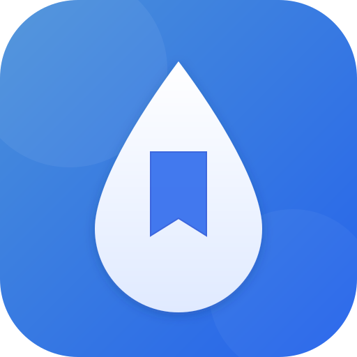

# Raindrop Shortcut

  

Raindrop.io のブックマークをツールバーからすばやく検索・アクセスできる Chrome / Firefox 拡張機能 (Manifest V3) です。

## 機能

- **ワンクリック一覧表示** — ツールバーのアイコンをクリックするだけで、ブックマークをコンパクトに表示
- **コレクション選択** — 表示するフォルダ（コレクション）を設定画面で切り替え可能
- **インクリメンタル検索** — タイトル・ドメイン名でリアルタイム絞り込み
- **ダークモード** — OS 設定に自動追従 / 手動切り替え
- **リンクの開き方切替** — 新しいタブ / 現在のタブを設定で選択可能
- **高速表示** — 選択中コレクションをバックグラウンドで定期取得し、アイコンクリック時はローカルキャッシュから即時表示

## インストール

- **Chrome Web Store**: [Raindrop Shortcuts](https://chromewebstore.google.com/detail/jdehenbjjipaibjccdblhdhffmlggdnp)
- **Firefox Add-ons (AMO)**: [Raindrop Shortcuts](https://addons.mozilla.org/firefox/addon/raindrop-shortcuts/)（Firefox 128 以降）

## 使い方

1. ツールバーの Raindrop Shortcut アイコンをクリック
2. 「ログイン」ボタンを押して Raindrop.io アカウントで認証（初回のみ）
3. ブックマーク一覧が表示されます
4. 設定（⚙ アイコン）から表示するコレクションを選択

検索欄では表示中のブックマークをタイトル・ドメイン名で絞り込めます。設定ではリンクの開き方（新しいタブ / 現在のタブ）とテーマ（自動 / ライト / ダーク）も変更できます。

## 困ったとき

- **追加したブックマークが見えない**: 一覧は5分間隔でバックグラウンド更新されます。最後の取得から5分以上経っている場合は、ポップアップを開き直すと、保存済み一覧を表示しながら最新データを取得します。
- **ネットワークエラーが出る**: 接続を確認してポップアップを開き直してください。認証が失効してログイン画面に戻った場合は、再度ログインしてください。
- **お問い合わせ**: 設定画面のサポートフッターから送信できます。初回はメールで届く確認コードによる本人確認が必要です。

## プライバシー

- OAuth 2.0 認証を使用。パスワードを拡張機能に入力する必要はありません
- 個人情報を自動収集しません。設定画面のお問い合わせフォームを送信した場合だけ、入力したメールアドレス・お名前（任意）・問い合わせ内容を Kagayoi Support へ送信します
- favicon 画像取得のためにブックマークのドメイン名のみ Google Favicon Service へ送信します
- ポップアップ UI の Web フォント (IBM Plex Sans JP / IBM Plex Mono) を Google Fonts CDN から取得します。オフライン時はシステムフォント (Yu Gothic UI / Hiragino Kaku Gothic ProN 等) にフォールバックします
- 詳細は [プライバシーポリシー](docs/privacy-policy.md) をご覧ください

## ライセンス

MIT

開発・ローカル読み込みの手順は [AGENTS.md](AGENTS.md)、実装の構成と設計判断は [DESIGN.md](DESIGN.md) を参照してください。
